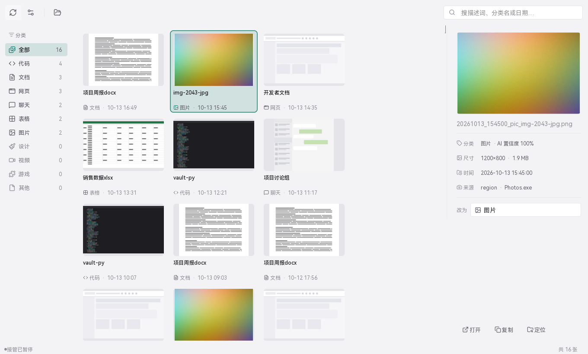
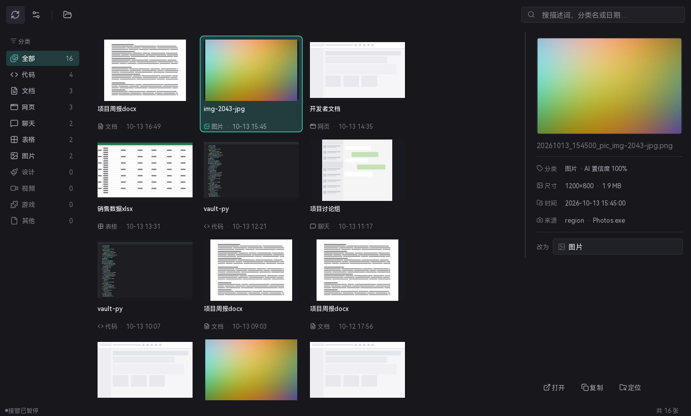

# SnapVault

**截图存下来之后，替你把它命名好、归好类、放好地方** —— 不再是一堆
`屏幕截图 (37).png` 全挤在一个文件夹里。

SnapVault 常驻托盘，盯着系统截图工具的落盘目录。你用 `Win+Shift+S` 截的每一张图，
它都会自动看一眼内容、判断属于哪一类、按规则命名、按分类归到子目录里，
之后可以在自带图库里按关键词、分类、日期搜出来。



<details>
<summary>深色主题</summary>



</details>

---

## 它解决什么问题

系统自带的截图工具只负责**截**，截完就完了：

- 文件名是 `屏幕截图 (37).png`，一周后你分不清第 37 张是什么；
- 所有图都堆在同一个目录，代码、聊天记录、发票、表情包混在一起；
- 想找回上周截的那张接口文档，只能靠一张张点开看。

SnapVault 补的就是这一段：**截完 → 自动命名 → 自动分类 → 归档 → 可检索**。

```
Win+Shift+S  ──▶  落盘  ──▶  SnapVault  ──▶  <图库>/代码/2026/10/20261014_143012_code_vault-py.png
                                            <图库>/文档/2026/10/20261014_142755_doc_项目周报docx.png
```

---

## 功能

| | |
| --- | --- |
| **接管系统截图** | 监视系统截图工具的输出目录，`Win+Shift+S` 的图自动被处理。**不修改系统应用本体**，不动注册表，不改文件关联 |
| **内容自动分类** | 10 类：代码 / 文档 / 网页 / 聊天 / 表格 / 图片 / 设计 / 视频 / 游戏 / 其他。本地规则判定，不联网也能用 |
| **自动命名** | 模板驱动，默认 `{date}_{time}_{category}_{slug}`，例如 `20261014_143012_code_vault-py.png` |
| **分类即文件夹** | 归档直接落到 `图库/<分类>/年/月/`，不只是加个文件名前缀 |
| **可检索图库** | 缩略图网格、分类筛选、关键词搜索，双击打开、定位到资源管理器 |
| **AI 命名与分类**（可选） | 接一个 OpenAI 兼容的多模态接口，让模型看一遍画面再起名 —— 比纯规则准。**默认开启，会联网，见「隐私」** |
| **无界面可用** | 命令行能批量导入、打印统计、跑体检，方便脚本化 |
| **依赖干净** | 只要 PySide6 + Pillow + numpy；所有 Win32 调用是纯 `ctypes`，不引入 pywin32 / OpenCV / mss |

---

## 安装

### 方式一：下载现成的（不需要 Python）

1. 到 [Releases](../../releases) 下载 `SnapVault-x.y.z-win64.zip`；
2. 解压到任意目录（**别放 C 盘根目录或 Program Files**，它要往图库里写文件）；
3. 双击 `SnapVault.exe`。

> **首次运行会有 SmartScreen 提示**：这个 exe 没有代码签名证书（个人项目自费买一张
> 不便宜），Windows 会显示"已保护你的电脑"。点「更多信息」→「仍要运行」即可。

### 方式二：从源码跑

需要 **Python 3.9+**（开发环境 3.11.4）和 Windows 10/11 64 位。

```powershell
git clone https://github.com/8uioiu8/snapvault.git
cd snapvault
python -m pip install PySide6 Pillow numpy

run.bat                 # 双击也行：自动挑 pythonw.exe，无控制台窗口
run.bat --console       # 想看得见日志就用这个
```

---

## 三分钟上手

1. **启动** —— 托盘出现一个取景框图标。首次启动要约 8 秒（Qt 起来 + 重建索引）。
2. **体检** —— 双击 `doctor.bat`（或 `SnapVault.exe --doctor`），它会逐环告诉你
   "现在截图会不会被接住"：

   ```
   [OK  ] 接管开关        已开启
   [OK  ] 监视目录        C:\Users\你\Pictures\Screenshots
   [OK  ] 接管进程        正在运行
   [OK  ] AI 命名         qwen3-vl-plus @ https://…
   ```

   任何一环断了都会标 `!!` 并点名。
3. **关掉 AI（可选，建议先看一眼）** —— 设置 →「AI 命名」。**它默认开着，会把整张
   截图发到第三方接口**，详见下面「隐私」一节。
4. **截一张试试** —— `Win+Shift+S` 随便截点什么，几秒后打开图库，它应该已经
   带着新名字和分类躺在里面了。

想开机自启：设置 →「界面与启动」→ 勾选"开机自动启动"。

---

## 命名与分类

默认命名模板是 `{date}_{time}_{category}_{slug}`：

```
20261014_143012_code_vault-py              ← 代码
20261014_142755_doc_项目周报docx            ← 文档
20261014_141903_web_开发者文档              ← 网页
20261014_140122_sheet_销售数据xlsx          ← 表格
20261014_135640_pic_sunset-over-sea        ← 图片
20261014_135640_pic_sunset-over-sea-2      ← 同秒重名自动加序号，不覆盖
```

模板可以在设置里改，也支持 `{label}`（分类中文名）、`{title}`（窗口标题原文）、
`{app}`（进程名）、`{hash}`、`{seq}` 等占位符。

分类可以自己增删改：名称、显示用的图标（39 颗内置图标任选）、以及判定关键词规则，
都在设置 →「分类管理」里。

---

## 隐私

> **这一节是重点。** 这是一个会"看到你屏幕"的工具，所以它读什么、写什么、
> 往外发什么，必须写清楚。

### 会往外发什么

| 情况 | 发出去的内容 | 发给谁 |
| --- | --- | --- |
| **AI 命名开着**（默认） | **每张截图的完整画面** + 你的提示词 | 你在设置里填的接口地址 |
| AI 命名关掉 | 什么都不发 | —— |
| 其余全部功能 | 什么都不发 | —— |

**开了 AI 命名，你截的每一张图都会离开这台电脑。** 截图里可能是聊天记录、邮件、
身份证、工资条、内部系统界面 —— 请自己判断要不要开。

- **不想上传** → 设置里关掉 AI 命名。分类退回本地规则（纯 numpy + Pillow，不联网），
  文件名退回 `日期_时间` 模板。功能少一点，但完全离线。
- **想用 AI 又不想出网** → 把接口地址改成自己局域网里的 OpenAI 兼容服务
  （本机的 Ollama、vLLM 都行）。地址在设置 →「AI 命名 → 接口地址」。

### 会写什么

| 写的东西 | 位置 |
| --- | --- |
| 归档图 | 图库目录（默认 `%USERPROFILE%\Pictures`） |
| 缩略图 / 索引 | 图库目录下的 `.snapvault/` |
| 配置 | `%LOCALAPPDATA%\SnapVault\config.json` —— **API Key 明文存储** |
| 日志 | 同目录 `snapvault.log`（只在异常时写） |

`config.json` 里有明文 Key，别把它连同项目一起发给别人，也别整个目录往网盘同步。

### 想把自己的图库分享给别人？

`index.jsonl` 里的**文件名本身就是情报**。清干净再发：

```
%APPDATA%\SnapVault\config.json      ← API Key / 你的绝对路径
<图库>/.snapvault/index.jsonl        ← 会暴露你在做什么项目
<图库>/.snapvault/watched.json       ← 绝对路径，暴露用户名
```

---

## 系统要求

| | |
| --- | --- |
| 系统 | Windows 10 / 11（64 位）。用了 Win32 的窗口枚举、DPI、热键、剪贴板，**不支持 macOS / Linux** |
| 下载版 | 不需要 Python，解压即用，约 115 MB |
| 源码版 | Python 3.9+，`pip install PySide6 Pillow numpy` |
| 内存 | 常驻约 100 MB（其中约 33 MB 是随包中文字体） |

---

## 许可

本仓库**代码**用 [MIT](LICENSE)。

随仓库分发的第三方作品各有其许可，其中字体带强制义务：

| 组件 | 许可 |
| --- | --- |
| [HarmonyOS Sans SC](snapvault/assets/fonts/)（界面字体） | HarmonyOS Sans Fonts License —— 允许随软件再分发**未修改**副本，但必须在软件中声明、不得改字体、不得单独分发字体、须随副本附协议全文 |
| [Lucide](https://lucide.dev)（39 颗图标，内联在 `icons.py`，无独立文件） | ISC（部分源自 Feather，MIT） |
| PySide6 / Qt | LGPL v3（依赖，仓库不含 Qt 文件） |

完整许可原文见 [`THIRD_PARTY_LICENSES.md`](THIRD_PARTY_LICENSES.md)；
界面内的声明在 设置 →「界面与启动 → 关于」。

> 不想要随包字体带来的体积和许可义务：删掉 `snapvault/assets/fonts/`，
> 程序会自动降级到系统字体。

---

## 更多

这份 README 只讲"这是什么、怎么用"。

设计规格、动效档位、性能优化过程（那些卡顿是怎么修掉的）、打包裁剪清单、
自检与回归测试的写法、命令行与配置项全表 —— 都在 [`DEVELOPMENT.md`](DEVELOPMENT.md)。
